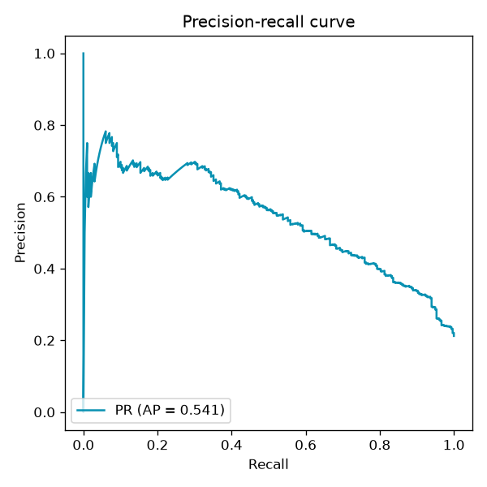

# ChurnGuard — Customer Churn Prediction Service

[](https://github.com/prathamshukla28/churnguard/actions/workflows/ci.yml)


An end-to-end machine-learning service that predicts which telecom customers are
about to churn, so a retention team can act *before* they leave. It covers the
full lifecycle — **data → features → training → evaluation → a served REST API** —
with the engineering practices (config-driven pipeline, no data leakage, tests,
Docker, CI) you'd expect in production.

> **Why churn?** For a subscription business, retaining a customer is far cheaper
> than acquiring a new one. Ranking customers by churn risk lets a small
> retention budget be spent where it matters most.

---

## Results

Trained on a Telco-style dataset (7,043 customers), the selected model reaches
the following on a held-out 20% test split:

| Metric | Value | Meaning |
| --- | --- | --- |
| **ROC-AUC** | **0.81** | Ranks a random churner above a random non-churner 81% of the time |
| **PR-AUC** | **0.54** | Strong vs. the 21% base churn rate |
| **Recall** | **0.76** | Catches 76% of customers who actually churn |
| **Precision** | **0.41** | Tunable via the decision threshold |
| **F1** | **0.54** | |

Three models (logistic regression, random forest, gradient boosting) are
compared by 5-fold cross-validated ROC-AUC; the best is selected automatically.

**Top churn drivers** (permutation importance): `tenure`, `Contract`,
`PaymentMethod`, `InternetService`, `TechSupport` — matching the known
real-world Telco churn story (new, month-to-month, electronic-check customers
churn most).

<p align="center">
  
  
  
</p>

---

## Architecture

```
                 config/config.yaml  (single source of truth)
                          │
   data.py ──► features.py ──► train.py ──► evaluate.py
 (dataset)    (engineering +   (CV model      (metrics.json,
              ColumnTransformer) selection +    figures, model card)
                                 persistence)
                          │
                          ▼
                 models/churnguard.joblib
                          │
                          ▼
   predict.py ──► api.py  (FastAPI: /health  /metrics  /predict)
                          │
                          ▼
                   Docker image  ──►  anywhere
```

Key design choices:

- **No data leakage.** All scaling / encoding lives inside a scikit-learn
  `Pipeline`, fitted on the training fold only, and cross-validated as one unit.
- **Train/serve parity.** The same `engineer_features()` runs at training time
  and at request time, so the model never sees differently-shaped inputs.
- **Config-driven.** Paths, the candidate models, CV folds and the target column
  all live in `config/config.yaml` — no magic numbers in the code.
- **Reproducible.** One fixed seed flows through data generation, splitting and
  modelling. `make all` rebuilds everything from scratch.

---

## Quickstart

```bash
# 1. Install
pip install -r requirements.txt     # or: make install

# 2. Build the dataset, train, and evaluate
make all                            # data + train + evaluate + tests

# 3. Serve the API
make serve                          # http://localhost:8000/docs
```

Score some customers:

```bash
curl -s -X POST http://localhost:8000/predict \
  -H "Content-Type: application/json" \
  -d '{"customers":[{"tenure":1,"MonthlyCharges":95,"TotalCharges":95,
       "Contract":"Month-to-month","InternetService":"Fiber optic",
       "PaymentMethod":"Electronic check","TechSupport":"No","SeniorCitizen":1}]}'
```

```json
{"predictions":[{"churn_probability":0.9748,"will_churn":true,"risk_band":"high"}]}
```

### Docker

```bash
make docker-build      # trains a model into the image
make docker-run        # serves on :8000, with a container HEALTHCHECK
```

---

## Project layout

```
churnguard/
├── churnguard/            # the Python package
│   ├── config.py          # typed, cached config loader
│   ├── data.py            # dataset generation / loading
│   ├── features.py        # feature engineering + ColumnTransformer
│   ├── train.py           # CV model selection + persistence
│   ├── evaluate.py        # metrics, figures, model card
│   ├── predict.py         # inference (shared by CLI + API)
│   └── api.py             # FastAPI service
├── config/config.yaml     # all tunable settings
├── tests/                 # pytest suite (data, features, training, API)
├── scripts/make_dataset.py
├── Dockerfile · Makefile · pyproject.toml · requirements.txt
└── .github/workflows/ci.yml
```

---

## Testing & quality

```bash
make test        # 16 tests: generation, feature parity, training, the API
ruff check .     # linting (also enforced in CI)
```

CI (GitHub Actions) runs lint + tests on Python 3.10 and 3.12, plus a smoke test
that the full `train → evaluate` pipeline runs end to end and produces artifacts.

---

## Using the real Telco dataset

The repo ships a **synthetic** dataset generator so it runs with zero downloads,
built to reproduce the real dataset's schema and churn drivers (see the
docstring in `churnguard/data.py`). To train on the genuine
[Telco Customer Churn](https://www.kaggle.com/datasets/blastchar/telco-customer-churn)
data, drop its CSV at `data/churn.csv` (same column names) and run `make train evaluate`.

---

## Possible extensions

- Hyper-parameter search (`GridSearchCV` / Optuna) and calibrated probabilities.
- Experiment tracking with MLflow; model registry + versioning.
- Threshold tuning against the business cost of a false negative vs. false positive.
- Drift monitoring on the live request stream.

## License

MIT
