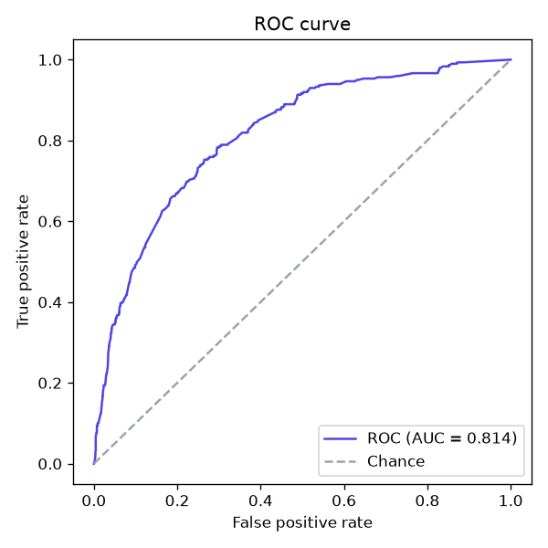
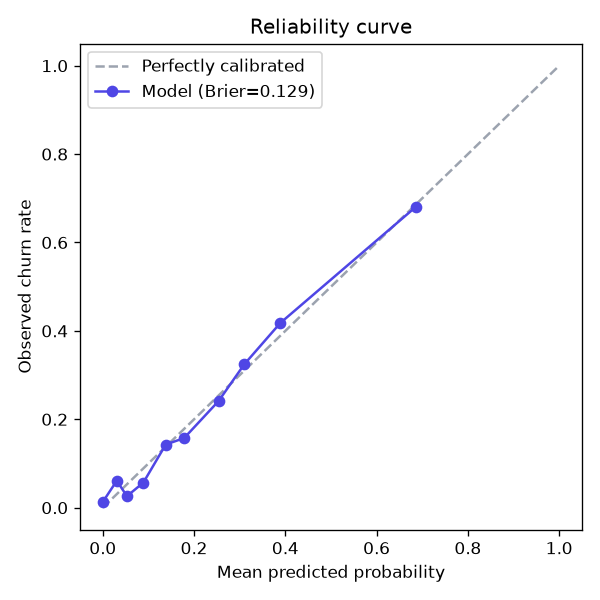
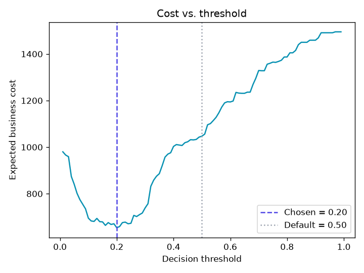
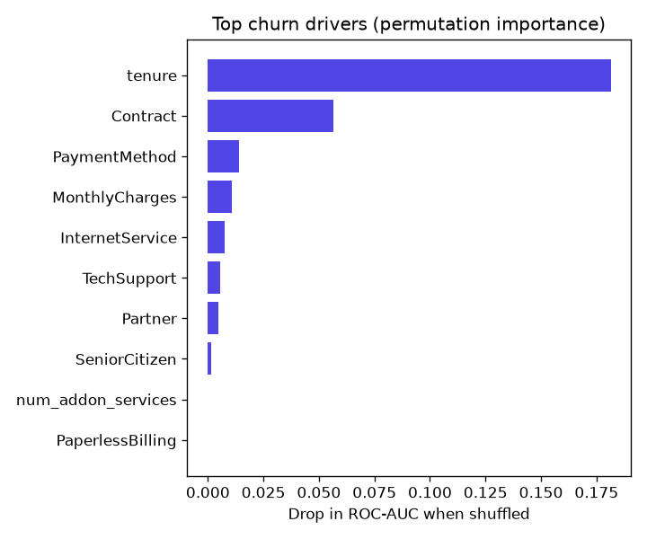

# ChurnGuard — Customer Churn Prediction Service

[](https://github.com/prathamshukla28/churnguard/actions/workflows/ci.yml)


An end-to-end machine-learning service that predicts which telecom customers are
about to churn, so a retention team can act *before* they leave. It covers the
full lifecycle — **data → features → training → evaluation → a served REST API** —
with the engineering practices (config-driven pipeline, no data leakage, tests,
Docker, CI) you'd expect in production.

> **Why churn?** For a subscription business, retaining a customer is far cheaper
> than acquiring a new one. Ranking customers by churn risk lets a small
> retention budget be spent where it matters most.

---

## Results

Trained on a Telco-style dataset (7,043 customers), the tuned and calibrated
model reaches the following on a held-out 20% test split:

| Metric | Value | Meaning |
| --- | --- | --- |
| **ROC-AUC** | **0.81** | Ranks a random churner above a random non-churner 81% of the time |
| **PR-AUC** | **0.54** | Strong vs. the 21% base churn rate |
| **Brier score** | **0.13** | Probabilities are well-calibrated (lower is better) |
| **Recall @ 0.20** | **0.79** | Catches 79% of customers who actually churn |
| **Precision @ 0.20** | **0.41** | At the business-chosen threshold |
| **F1 @ 0.20** | **0.54** | |

Three models (logistic regression, random forest, gradient boosting) are compared
by 5-fold cross-validated ROC-AUC; the winner is then **hyperparameter-tuned**
(randomized search) and **probability-calibrated** (isotonic). The decision
threshold is **chosen to minimise business cost**, not left at 0.5 — which cut
expected cost on the test set by ~37% (from 1047 to 654 with cost_fn=5, cost_fp=1).

**Top churn drivers** (permutation importance): `tenure`, `Contract`,
`PaymentMethod`, `MonthlyCharges`, `InternetService` — matching the known
real-world Telco churn story (new, month-to-month, electronic-check customers
churn most). Every individual prediction also gets its own **SHAP explanation**.

<p align="center">
  
  
  
  
</p>

---

## Architecture

```
                 config/config.yaml  (single source of truth)
                          │
   data.py ──► features.py ──► train.py ──────────► evaluate.py
 (real or     (engineering +   (CV select →         (threshold choice,
  synthetic)   ColumnTransformer) tune → calibrate)   metrics, figures,
                          │                            calibration + cost curves)
                          ▼
              models/churnguard.joblib  (ModelBundle: model + threshold + SHAP background)
                          │
            ┌─────────────┴──────────────┐
            ▼                             ▼
   explain.py (SHAP)            predict.py ──► api.py
                                (batch CLI)    (/  /health  /metrics  /stats  /predict)
                          │
                          ▼
                   Docker image  ──►  Render / HF Spaces / anywhere

   MLflow logs every training + evaluation run to ./mlruns (best-effort).
```

Key design choices:

- **No data leakage.** All scaling / encoding lives inside a scikit-learn
  `Pipeline`, fitted on the training fold only, and cross-validated as one unit.
- **Train/serve parity.** The same `engineer_features()` runs at training time
  and at request time, so the model never sees differently-shaped inputs.
- **Config-driven.** Paths, the candidate models, CV folds and the target column
  all live in `config/config.yaml` — no magic numbers in the code.
- **Reproducible.** One fixed seed flows through data generation, splitting and
  modelling; `requirements.lock` pins the exact dependency tree. `make all`
  rebuilds everything from scratch.
- **Calibrated & cost-aware.** Probabilities are calibrated (isotonic) so "0.7"
  means roughly 70%, and the decision threshold is picked to minimise expected
  business cost rather than defaulting to 0.5.
- **Explainable.** Every prediction returns its top SHAP risk drivers mapped
  back to business-readable columns (e.g. `Contract`, not a one-hot column).
- **Typed & observable.** `mypy` in CI, a `/stats` endpoint, and best-effort
  MLflow experiment tracking.

---

## Quickstart

```bash
# 1. Install
pip install -r requirements.txt     # or: make install

# 2. Build the dataset, train, and evaluate
make all                            # data + train + evaluate + tests

# 3. Serve the API
make serve                          # http://localhost:8000/docs
```

Score a customer and ask *why*:

```bash
curl -s -X POST http://localhost:8000/predict \
  -H "Content-Type: application/json" \
  -d '{"explain":true,"customers":[{"tenure":1,"MonthlyCharges":95,"TotalCharges":95,
       "Contract":"Month-to-month","InternetService":"Fiber optic",
       "PaymentMethod":"Electronic check","TechSupport":"No","SeniorCitizen":1}]}'
```

```json
{"predictions":[{"churn_probability":0.97,"will_churn":true,"risk_band":"high",
  "reasons":[{"feature":"tenure","value":1,"impact":0.9,"direction":"increases risk"},
             {"feature":"Contract","value":"Month-to-month","impact":0.6,"direction":"increases risk"}]}]}
```

Score a whole CSV from the command line:

```bash
python -m churnguard.predict customers.csv --out scored.csv --explain
```

### Docker

```bash
make docker-build      # trains a model into the image
make docker-run        # serves on :8000, with a container HEALTHCHECK
```

---

## Project layout

```
churnguard/
├── churnguard/            # the Python package
│   ├── config.py          # typed, cached config loader
│   ├── data.py            # dataset generation / loading / real-data download
│   ├── features.py        # feature engineering + ColumnTransformer
│   ├── train.py           # CV selection → tuning → calibration
│   ├── bundle.py          # the saved model artifact (model + threshold + SHAP background)
│   ├── evaluate.py        # metrics, figures, business threshold, model card
│   ├── explain.py         # per-prediction SHAP explanations
│   ├── predict.py         # inference + batch CSV CLI (shared by API)
│   ├── tracking.py        # best-effort MLflow logging
│   └── api.py             # FastAPI service (+ interactive demo page)
├── config/config.yaml     # all tunable settings
├── tests/                 # pytest suite (data, features, training, explain, API, CLI)
├── scripts/               # make_dataset.py · download_data.py
├── Dockerfile · Makefile · pyproject.toml · requirements.txt · requirements.lock
├── .pre-commit-config.yaml
└── .github/workflows/ci.yml
```

---

## Testing & quality

```bash
make test        # 25 tests: generation, feature parity, training, SHAP, API, CLI
make coverage    # tests + coverage report
make lint        # ruff
make typecheck   # mypy
pre-commit install   # run ruff + mypy automatically on every commit
```

CI (GitHub Actions) runs **ruff + mypy + tests with coverage** on Python 3.10 and
3.12, plus a smoke test that the full `train → evaluate` pipeline runs end to end
and produces artifacts.

---

## Using the real Telco dataset

The repo ships a **synthetic** dataset generator so it runs with zero downloads,
built to reproduce the real dataset's schema and churn drivers (see the docstring
in `churnguard/data.py`). To train on the genuine
[Telco Customer Churn](https://www.kaggle.com/datasets/blastchar/telco-customer-churn)
data, run `make data-real` (downloads the real CSV) and then `make train evaluate`.

---

## Possible extensions

- A model registry + automated promotion on top of the MLflow runs.
- Concept-drift monitoring on the live request stream (the `/stats` endpoint is a start).
- Online threshold re-tuning as the real cost ratio changes.
- A small front-end dashboard over the batch scores.

## License

MIT
