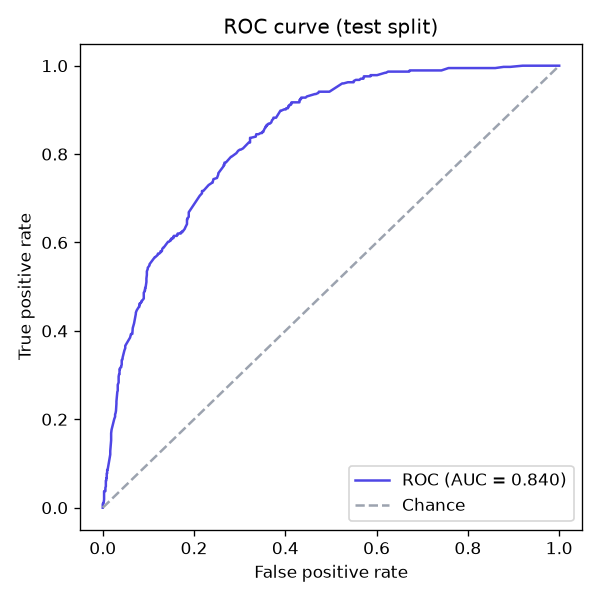
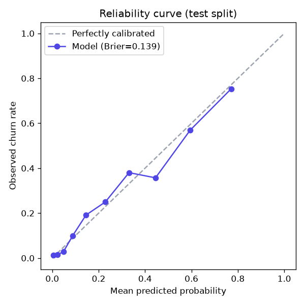
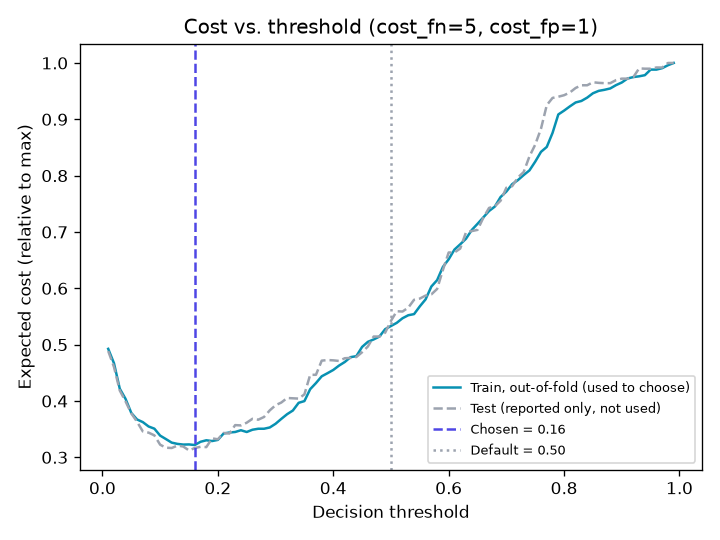
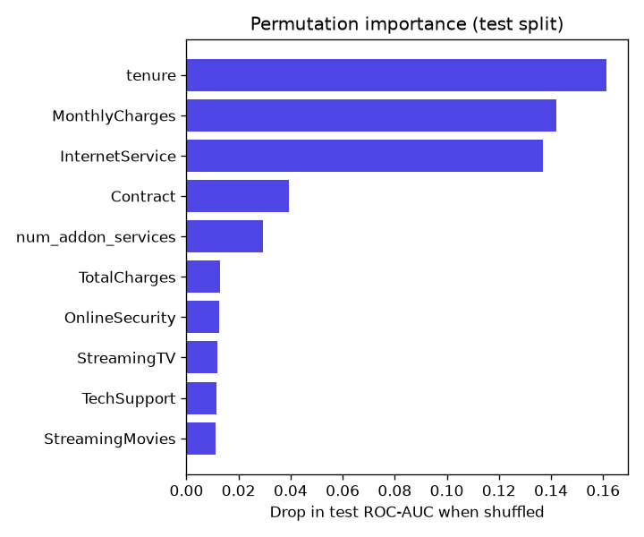

# ChurnGuard — Customer Churn Prediction Service

[](https://github.com/prathamshukla28/churnguard/actions/workflows/ci.yml)


An end-to-end machine-learning service that ranks telecom customers by churn risk
so a retention team can act *before* they leave: **data → features → training →
evaluation → a served REST API → drift monitoring → model lifecycle**, trained and
evaluated on the public **IBM Telco Customer Churn** dataset.

> **Live demo:** _not deployed yet_ — see [Deploy](#deploy).
>
> [](https://render.com/deploy?repo=https://github.com/prathamshukla28/churnguard)

---

## Results & limitations

Real data: the IBM *Telco Customer Churn* sample (7,043 customers, 26.5% churn),
downloaded from IBM's GitHub and verified by SHA-256. Stratified 80/20 split
(seed 42). **Model selection, tuning, calibration and the decision threshold use
the training split only; the test split (n = 1,409) is scored once.**

| Metric (held-out test) | Value | 95% bootstrap CI |
| --- | --- | --- |
| **ROC-AUC** | **0.840** | 0.817 – 0.862 |
| **PR-AUC** | **0.625** | 0.571 – 0.676 (base rate 0.265) |
| **Brier score** | **0.139** | always predicting the base rate scores 0.195 |
| Recall @ 0.16 | 0.91 | |
| Precision @ 0.16 | 0.45 | |
| F1 @ 0.16 | 0.60 | |
| Customers flagged @ 0.16 | 54% | |

- **Model:** logistic regression (C≈21), isotonic-calibrated. Cross-validated
  ROC-AUC on the training split: random forest 0.848, gradient boosting 0.848,
  logistic regression 0.846. The gap is far smaller than the fold-to-fold noise,
  so the **one-standard-error rule** picks the simplest model. It has exact SHAP
  values and predicts about 15× faster than the calibrated forest (≈48 ms vs.
  ≈740 ms per single-row `predict_proba` on the same loaded laptop). (A tuned forest
  scored 0.844 on the same test split, inside the interval above.)
- **Threshold 0.16**, chosen to minimise expected cost with an **assumed** 5:1
  cost of a missed churner vs. a wasted offer, on **out-of-fold** predictions over
  the training split. On the untouched test split it costs 592 vs. 1,014 at the
  default 0.5 (−42%). That saving holds only if the 5:1 ratio is real.
- **Drivers** (permutation importance on test): `tenure`, `MonthlyCharges`,
  `InternetService`, `Contract`, `num_addon_services`. These are associations, not
  causes.

**Where it fails** (test split, at the 0.16 threshold; full table in
[`reports/model_card.md`](reports/model_card.md)):

| Segment | n | Churn rate | ROC-AUC | Precision | Recall |
| --- | --- | --- | --- | --- | --- |
| Contract = Two year | 336 | 3% | 0.77 | 0.00 | **0.00** (misses all 9 churners) |
| Contract = One year | 300 | 12% | 0.74 | 0.25 | **0.56** |
| Contract = Month-to-month | 773 | 43% | 0.74 | 0.47 | 0.97 (flags 88% of them) |
| Tenure 0–12 months | 449 | 48% | 0.74 | 0.53 | 0.97 |
| Senior citizens | 222 | 44% | 0.77 | 0.54 | 0.98 (flags 80%) |

- Most of the ranking power is *between* segments (contract type, tenure). Within
  a contract or tenure segment ROC-AUC drops to 0.74–0.83. In practice the model separates
  month-to-month newcomers from long-contract customers and says little about who
  *within* the month-to-month group will leave.
- Churners on one- and two-year contracts are mostly missed. If those customers
  matter, they need their own threshold or model.
- At this threshold over half the base is flagged. That only makes sense for a
  cheap retention action; for an expensive one, raise `threshold.cost_fp`.
- One static snapshot with no timestamps, so no out-of-time validation. IBM
  describes the data as a fictional telco, so expect real deployments to be worse.
- Explanations come from a weakly regularised linear model with correlated
  pricing columns (`MonthlyCharges` is almost a function of the services held).
  Credit can split between them in counter-intuitive ways, e.g. a high
  `MonthlyCharges` shown as "decreases risk" once the services are accounted for.

**Reproduce every number above:**

```bash
make install-dev          # pinned deps (requirements-dev.lock, Python 3.12)
make all                  # download + verify data → train once → evaluate → gate → checks
```

<p align="center">
  
  
  
  
</p>

> **About synthetic data.** `churnguard/data.py` also contains a synthetic
> generator with the same schema. Its label comes from a hand-written logistic
> formula, so a model trained on it just recovers that formula. It is used **only**
> by the unit tests (fast, offline) and never for any reported number. Earlier
> versions of this README quoted synthetic-data metrics; they have been replaced
> by the real-data results above.

---

## Architecture

```
                 config/config.yaml  (single source of truth)
                          │
   data.py ──► features.py ──► train.py ───────────────► evaluate.py
 (real Telco,  (normalise +    (CV select → 1-SE rule →   (loads the saved model,
  SHA-256      engineer +       tune → calibrate →         scores the untouched test
  verified)    ColumnTransformer) OOF threshold)           split once: metrics, CIs,
                          │                                segments, figures, card)
                          ▼
              models/churnguard.joblib  (ModelBundle: model + threshold + data hash
                          │              + held-out row ids + SHAP background)
            ┌─────────────┼──────────────────┬─────────────────┐
            ▼             ▼                  ▼                 ▼
   explain.py (SHAP)  predict.py ──► api.py   monitor.py (PSI)  registry.py + retrain.py
                      (batch CLI)   (REST)                      (champion/challenger)
                                                 quality.py: regression gate vs. the
                                                 frozen, committed baseline
```

Key design choices:

- **No leakage, including the decision layer.** Scaling/encoding live inside a
  scikit-learn `Pipeline` fitted on training folds. The threshold is chosen on
  out-of-fold training predictions. `evaluate` never trains or chooses anything;
  tests enforce both.
- **Train once.** `make all` and the Docker build train a single time; `evaluate`
  loads the artifact and refuses to run if the data changed since training.
- **Train/serve parity.** The same `normalize_schema()` + `engineer_features()` run
  at training and request time (blank `TotalCharges`, 0/1 `SeniorCitizen`, and so on).
- **Calibrated & cost-aware.** Isotonic calibration; a cost-minimising threshold;
  risk bands derived from that threshold, so `will_churn` and `risk_band` never
  disagree (`low` < threshold ≤ `medium` < 0.5 ≤ `high`).
- **A quality gate that can fail.** `reports/baseline_metrics.json` is frozen and
  committed; only `make promote-baseline` writes it. CI retrains on the real data
  and fails if ROC-AUC/PR-AUC drop or Brier rises by more than 0.02.
- **Reproducible.** One seed, a checksum-pinned dataset, and pip-tools locks
  (`requirements.lock` for runtime/Docker, `requirements-dev.lock` for CI/dev).

---

## Quickstart

```bash
make install-dev      # pinned runtime + dev tools
make all              # data → train → evaluate → regression gate → lint/types/tests
make serve            # http://localhost:8000  (demo page) · /docs (OpenAPI)
```

Score a customer and ask *why* (a real-looking full record):

```bash
curl -s -X POST localhost:8000/predict -H "Content-Type: application/json" -d '{
  "explain": true,
  "customers": [{"gender":"Female","SeniorCitizen":0,"Partner":"No","Dependents":"No",
    "tenure":2,"PhoneService":"Yes","MultipleLines":"No","InternetService":"Fiber optic",
    "OnlineSecurity":"No","OnlineBackup":"No","DeviceProtection":"No","TechSupport":"No",
    "StreamingTV":"No","StreamingMovies":"No","Contract":"Month-to-month",
    "PaperlessBilling":"Yes","PaymentMethod":"Electronic check",
    "MonthlyCharges":70.7,"TotalCharges":151.65}]}'
```

```json
{"predictions":[{"churn_probability":0.7397,"will_churn":true,"risk_band":"high",
  "reasons":[{"feature":"InternetService","value":"Fiber optic","impact":1.41,"direction":"increases risk"},
             {"feature":"tenure","value":2.0,"impact":1.37,"direction":"increases risk"},
             {"feature":"num_addon_services","value":0,"impact":-0.74,"direction":"decreases risk"}]}],
 "threshold":0.16,
 "explanation_basis":{"explained_model":"uncalibrated base estimator (logistic_regression)",
   "impact_units":"log-odds","note":"Reasons explain the uncalibrated base model; ..."}}
```

(Among the 313 real customers with fiber, a month-to-month contract, electronic
check payment and ≤3 months of tenure, 79% churned.)

- **Partial records are fine.** Omitted fields are imputed by the fitted pipeline
  (median / most frequent); nothing silently defaults to 0.
- **`reasons` explain the uncalibrated base model**, in log-odds, while
  `churn_probability` is calibrated. Directions and ranking carry over; the impacts
  do not sum to the probability. Every explained response says so in
  `explanation_basis`.

Score a whole CSV: `python -m churnguard.predict customers.csv --out scored.csv --explain`.

---

## Security & configuration

| Setting | Default | Effect |
| --- | --- | --- |
| `CHURNGUARD_API_KEY` | unset (open) | Require `X-API-Key` on `/predict`, `/monitor` (constant-time compare). |
| `CHURNGUARD_PROTECT_OPS=1` / `serving.protect_ops_endpoints` | off | Also require the key on `/metrics`, `/metrics/prometheus`, `/stats` (fails closed with no key). |
| `CHURNGUARD_TRUST_PROXY=1` / `serving.trust_forwarded_for` | off | Key rate limits on `X-Forwarded-For` (`trusted_proxy_hops` from the right). Enable **only** behind your own proxy; otherwise clients could spoof it. |
| `CHURNGUARD_RATE_LIMIT` | 120/min | Per-client fixed window; tracked clients are bounded (stale windows evicted, hard cap). |

Prometheus series are labelled by the matched **route template** (`/predict`) or
`unmatched`, never the raw path, and unknown HTTP methods collapse to `OTHER`. A
scan of random URLs cannot create unbounded time series.

---

## Testing & quality

```bash
make test        # 107 tests (synthetic data, offline, isolated temp dirs)
make coverage    # fails under 90% (currently ~94%)
make lint        # ruff check + ruff format --check
make typecheck   # mypy
make regression  # model gate vs. the committed baseline
```

The suite runs against a temporary config (`CHURNGUARD_CONFIG`), so it never reads
the real data or overwrites your model and reports. Notable guarantees under test:
the threshold never sees a test row; `evaluate` never trains, chooses a threshold
or writes the baseline; the CI gate script exits 1 when metrics drop; bands never
contradict `will_churn`; omitted fields are imputed; and the 404 scan, spoofed
`X-Forwarded-For`, limiter memory bound and ops-endpoint auth behave as described.

CI: lint, types and tests on Python 3.12 (pinned `requirements-dev.lock`) and 3.10
(declared lower bounds), plus a **real-data job** that downloads the data, trains
once, evaluates, checks that the committed baseline is untouched, and runs the
regression gate.

---

## Docker

```bash
make docker-build   # builder stage: download + verify data, train once, evaluate
make docker-run     # runtime stage: requirements.lock only, non-root, HEALTHCHECK
```

Both stages install from `requirements.lock`; dev tooling (pytest, mypy, ruff,
mlflow, pre-commit) never enters the image.

## Deploy

`render.yaml` is a Render blueprint (free Docker web service, `/health` check,
`CHURNGUARD_TRUST_PROXY=1`). Click **Deploy to Render** above, or on render.com:
**New → Blueprint → this repo**. The image downloads and checksum-verifies the
Telco data and trains its own model during the build, so no artifacts need to be
committed. The free plan sleeps when idle, so the first request after a pause
takes ~30–60 s. Once it is live, put the URL in the *Live demo* line at the top
of this README.

---

## Operations

See [`docs/DESIGN.md`](docs/DESIGN.md), [`docs/RUNBOOK.md`](docs/RUNBOOK.md) and the
decision records in [`docs/adr/`](docs/adr/).

- **Drift:** `python -m churnguard.monitor recent.csv` or `POST /monitor`: PSI per
  feature, prediction drift and (with labels) performance drift against the
  reference profile. It runs on demand; nothing schedules it or alerts yet.
- **Retrain:** `make retrain` fingerprints the data and **skips** if it matches the
  champion's (a seeded retrain on identical data reproduces the same model).
  Otherwise it trains, applies the regression gate, registers, and promotes only
  if the challenger beats the champion: the local registry's production model, or
  the committed baseline on a fresh checkout or CI runner. The monthly workflow
  therefore does nothing until the data source is refreshed.
- **Move the quality floor:** `make promote-baseline`, review, commit.
- **Benchmark:** `make loadtest` writes `reports/loadtest.md`. The committed run
  was taken on a heavily loaded laptop (load average 10–15); re-run it on a quiet
  machine before quoting latency.

## Project layout

```
churnguard/        config · data · features · train · decision · bundle · evaluate ·
                   explain · predict · quality · registry · retrain · monitor ·
                   observability · tracking · api
config/config.yaml all tunable settings (data source + checksum, CV, costs, serving)
tests/             pytest suite (isolated synthetic config)
reports/           committed metrics, model card, figures, frozen baseline, drift reference
docs/              DESIGN · RUNBOOK · adr/
scripts/           download_data · make_dataset · retrain · check_regression · loadtest
Dockerfile · Makefile · pyproject.toml · requirements{,-dev}.{txt,lock} · render.yaml
```

The dataset is downloaded, not committed: cite IBM, don't redistribute.

## License

MIT
